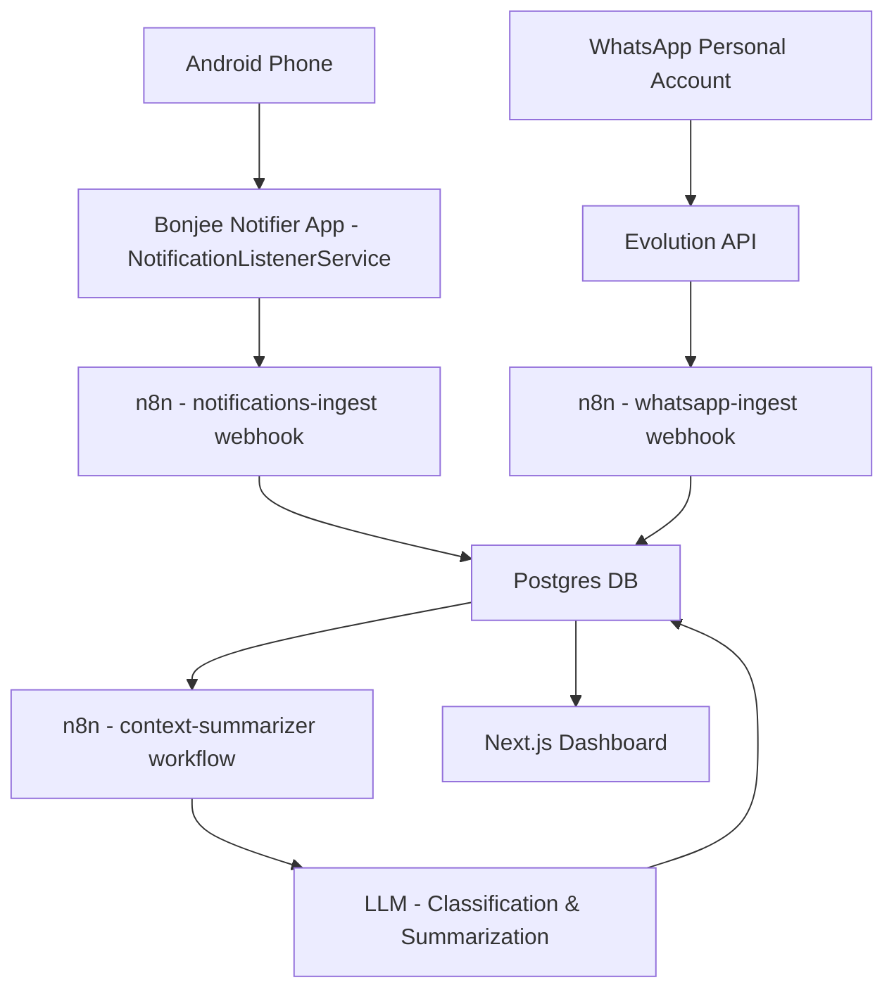

# Architecture

## Overview
Bonjee Bot is an event driven personal briefing system. Instead of summarizing on a fixed interval, n8n will evaluate every new message/notification and decide if a summary should be generated based off of context. 

## Data Flow



## Components

| Component | Purpose | Hosting |
| :-- | :-- | :-- |
| Evolution API | QR pair with your personal WhatsApp, forward DMs and Groups via webhooks | Render Web Service + Persistent Disk |
| n8n | Ingest, normalize, classify, deduplicate, and decide when to summarize | Render Web Service + Postgres |
| Postgres | Source of truth for messages, notifications, summaries, and state | Render Managed Postgres |
| Android Notifier App | Uses `NotificationListenerService` to grab all notifications and POST them to n8n | Sideloaded APK onto your Android device |
| Next.js Dashboard | View latest brief, deadlines, action items, timeline, and settings | Render Web Service/Static Site | 

## Phone Commands (offline)

The Android app answers a set of spoken/typed sentences on the phone itself before it
touches the network. `device/DeviceActions.kt` is the engine and
`device/CommandCatalog.kt` is the single list of supported sentences (also shown on the
Device Commands screen and spoken for "what can you do").

| Group | Examples | How it works |
| :-- | :-- | :-- |
| Apps | `open WhatsApp`, `launch Gmail` | Resolves launcher activities through `<queries>` (MAIN/LAUNCHER), no `QUERY_ALL_PACKAGES` |
| Calls / texts | `call mum`, `text John saying I am coming` | Contacts lookup + `ACTION_CALL` (falls back to `ACTION_DIAL` without `CALL_PHONE`); SMS is sent directly once `SEND_SMS` is granted, otherwise composed |
| WhatsApp | `call John on WhatsApp`, `whatsapp Ada saying hello` | Opens the chat via `wa.me`; `TapAssistService` (optional accessibility helper) presses call/send inside WhatsApp, which has no public API for either |
| Contacts | `search contacts for Ada`, `what is John's number` | Searchable contact screen with call / WhatsApp call / video / WhatsApp message / SMS |
| Screen / sound | `brightness 60 percent`, `volume up`, `mute` | `Settings.System` when "Modify system settings" is granted, otherwise window brightness; `AudioManager` for volume/ringer |
| Quick controls | `torch on`, `next song`, `set alarm for 6:30 am` | Camera2 torch, media key events, `AlarmClock` / calendar insert intents |
| Search | `youtube ...`, `navigate to ...`, `search for ...` | `ACTION_VIEW` deep links to the installed app or browser |
| Panels | `wifi`, `bluetooth`, `location` | Opens the system panel and says so; Android forbids silent toggles |
| Info | `battery`, `time`, `storage`, `read my notifications` | Local APIs + the listener's last 20 notifications |

It runs inside the existing assistant flow: `AskActivity` offers every sentence to the
engine first, and `NotHandled` falls through to the same `personal-ai-ask` webhook, so
archive questions behave exactly as before (including offline failures).

### Chained commands

`device/CommandChain.kt` splits one sentence on `then`, `and then`, `after that`,
`afterwards`, `after which`, a semicolon or a newline, plus the spoken shape
`open <app> and <rest>`. Plain "and" inside a message body is never a separator, and
"next" only splits when an action follows it (so `next song` stays one command).

Up to five steps run left to right through the same single-action router. Context is
carried forward: after `open WhatsApp`, a bare `message John` becomes a WhatsApp chat,
`call him` becomes a WhatsApp call, `search for John` becomes WhatsApp search, and
`open the chat` reuses the last contact.

Examples:

| Sentence | Steps |
| :-- | :-- |
| `open WhatsApp then message John` | open app, WhatsApp chat |
| `open WhatsApp and message John saying I am coming` | open app, WhatsApp message |
| `open WhatsApp and search for John then open the chat` | open app, open chat, reuse chat |
| `open contacts then call Ada` | contacts screen, phone call |

Safety: if a later step needs a permission or a settings screen, the steps that already
ran are reported and are **not** replayed automatically, so a chained send cannot happen
twice. When nothing has run yet, the whole sentence is replayed after the grant. If the
first step is not a device action, the original sentence goes to the workflow unchanged.

## Native modules (no dashboard required)

| Drawer item | Screen | Data source |
| :-- | :-- | :-- |
| Memory Core | `MemoryActivity` + `MemoryGraphView` | Local contact rules, captured messages and notes; graph drawn natively. `memory.search` is an explicit button with the real HTTP answer |
| Inbox | `MessageInboxActivity` | `MessageStore` written by the notification listener |
| Tasks | `TasksActivity` + `LocalTaskStore` | SharedPreferences task list; optional `task.create` sync reports the real result |
| Calendar | `CalendarActivity` | Device `CalendarContract.Instances`, upcoming 60 days; new events open the system insert screen |
| Automations | `AutomationsActivity` | Real `Prefs` switches for capture, announcements, quiet hours, privacy, auto-reply and tap assist, plus honest permission/endpoint status |
| Devices & n8n | `MessageSettingsActivity` | Endpoint, device registration and self-checks |
| Message Rules | `ContactRulesActivity` | Important / Auto-Reply / Other with server authorisation |

`WebModuleActivity` still exists but no drawer route uses it: the Next.js dashboard is
not deployed, so pointing the menu at it only produced a dead WebView.

## Summoning the assistant

| Route | How | Notes |
| :-- | :-- | :-- |
| Assistant role | Settings > Default apps > Digital assistant app > JARVIS | System gesture (corner swipe / home or power long-press) then opens the home card and starts listening |
| ACTION_ASSIST | Launchers and OEM triggers that skip the session | Handled by `JarvisHomeActivity` directly |
| Quick Settings tile | "Ask JARVIS" tile in the shade | Same `ACTION_ASSIST` intent, one tap from any screen |
| App shortcut | Long-press the JARVIS icon > "Ask JARVIS" | Android 7.1+ |
| Lock screen | Same assistant gesture while locked | The session draws its own card above the keyguard |

Always-on "Hey Google"-style hotword is not available to third-party apps: Android only
grants hotword capture to a system-signed `HotwordDetectionService`, so JARVIS cannot
answer to a wake word with the screen off.

## WhatsApp rules, announcements and reply approval

The app adds one local pipeline on top of the existing notification capture. It does not
replace the archive webhook and it does not add a second workflow.

```
WhatsApp notification
  └─ NotificationListenerService.onNotificationPosted
       ├─ existing capture  → remember() + DeliveryQueue → notifications-ingest (unchanged)
       └─ WhatsAppWatcher (only com.whatsapp / com.whatsapp.w4b, failures contained)
            ├─ parse sender/body/type, resolve number via READ_CONTACTS (optional)
            ├─ dedupe (conversation + text + 15 s window) → MessageStore
            ├─ ContactRulesStore: Important / Auto-Reply / Other
            ├─ ImportantNotifier (local, high-priority, body hidden on lock screen)
            ├─ Announcer + AudioPolicy (TTS, DND/silent/quiet-hours aware)
            └─ AutoReplyPolicy → JarvisApi (/webhook/app-api, envelope v1)
```

### Why the notification listener is the delivery path

The build has no Firebase dependency, so a closed app is woken by the notification
listener the user explicitly enabled - not by an invented push channel. `device.register`
sends `push_provider: "none"`. FCM is documented in `docs/API_CONTRACT.md` §7 as optional
backend work; the app never claims to receive push today. OEM battery managers can delay
a restarted listener after the process is killed, so a missed message is a known limit,
not a silent success.

### Categories are not permissions

| Bucket | Shown | Announced | May auto-reply |
| :-- | :-- | :-- | :-- |
| Important | High-priority notification | Yes, subject to audio rules | **Only if also** in Auto-Reply *and* enabled *and* server-authorised |
| Auto-Reply | Normal notification | No | Only with per-contact enable + server authorisation |
| Other / new number | Normal notification (opt-out) | No | Never |

`ContactRule.sanitized()` enforces this on every write and on every load, so a hand-edited
JSON file cannot create an "Other" contact with auto-reply on. Numbers are normalised to
E.164 (`PhoneNumber`) and keyed on that, so `0803 123 4567`, `+2348031234567` and
`2348031234567` are one record.

### Audio: honest about Android

`AudioPolicy` is pure logic; `Announcer` only reads real system state. Order: not
important → announcements off → call in progress → quiet hours → DND (unless the earphone
exception applies and a private output is actually connected) → silent/vibrate. Body text
is spoken only through earphones unless the user explicitly allowed the loudspeaker. The
optional volume behaviour raises media volume only while speaking and restores it; it
skips silent mode entirely. The app never requests notification-policy access and cannot
and does not claim to override Do Not Disturb. When speech is suppressed the notification
says which rule held it.

### Message lifecycle

```
received → pending_approval → approved → sending → sent
        ↘ cancelled          ↘ cancelled   ↘ failed → pending_approval (re-approval)
```

`ReplyFlow` is the only transition table; `MessageRecord.transition()` returns null for an
illegal move, so `received → sent` is impossible. Only a backend `status` of `sent`
renders SENT. A timeout is not a failure to retry: the app calls `reply.status` first, and
a later "sent" resolves the record without a second send. Request ids are deterministic
for sends (`send-<message_id>-r<attempt>`), which lets the workflow de-duplicate a replay.

### Reply screen guarantees

- `reply.generate` (`mode: approval`) returns a draft and never sends.
- The full text is shown in an editable field and can be read aloud; neither sends.
- APPROVE & SEND opens a dialog with the exact recipient and text, then calls
  `reply.approve` with that exact string and `auto: false`.
- REPLY MYSELF opens `wa.me/<number>` and never calls `reply.approve`.
- CANCEL calls `reply.cancel` and keeps the draft locally.
- Every failure shows the real HTTP result; there is no simulated success.

### One workflow, one app endpoint

All new app requests go to the single configurable path (default
`/webhook/app-api`) with the same envelope. The Evolution inbound webhook
(`/webhook/personal-ai-whatsapp`) stays server-to-server and untouched. Full action
schemas, auth rules, SQL migrations and the n8n node checklist are in
`docs/API_CONTRACT.md`.

### Storage

SharedPreferences + `org.json` (the project's existing pattern), so no new dependency is
needed:

| File | Key | Contents |
| :-- | :-- | :-- |
| `bonjee_whatsapp` | `contact_rules_v1` | Contact rules as a JSON array, E.164 keys |
| `bonjee_whatsapp` | `messages_v1` | Last 300 message/draft records |

Server-authorised auto-reply numbers live in the main prefs and are written only from a
backend response - a local toggle alone is never authorisation.

## Context Based Timing
The `context-summarizer` workflow will run after every ingest, or be triggered internally. It will check the following rules against the newly ingested items: 

| Rule | Condition | Action |
| :-- | :-- | :-- |
| Urgent Keywords | Contains words like `asap`, `urgent`, `emergency`, `deadline`, `due`, `overdue`, `pay now` | Flag as urgent, potentially trigger immediate summary if not in debounce window |
| Direct Mentions | You're @'d in a group, or your name is mentioned. Also works for DMs asking for you directly | Increase priority score |
| Questions/Requests | LLM classifies as "needs action", "question directed to you", or "request" | Becomes an action item, can trigger summary |
| Time Entities | Extracted dates/times (e.g "tomorrow at 5pm", "friday", "25th Oct", "by EOD") | Added to `deadlines` table, prioritized if within 24 hours |
| Burst Detection | >= 5 new items within the last 15 minutes | Treat as a busy period and summarize to catch you up |
| High Priority Apps | Notifications from apps such as Gmail, Google Calendar, Outlook, Banking apps, etc. containing time/event info | Boost priority | 

To prevent spam, we use a `context_state` table with `last_summary_at`, `debounce_until`, and `priority_score`. Summaries will only be generated if `priority_score >= THRESHOLD` or if it's been over a configurable cooldown period with new relevant items. 

## Security Notes
- All webhooks from your phone should be sent over HTTPS
- Use strong credentials for n8n, Postgres, and Evolution API
- Consider putting n8n behind basic auth or IP restrictions if needed
- The Android app only needs to hit your n8n webhook, no other external endpoints
- All data stays within your Render services + DB
- RLS should be enabled for the dashboard if you add auth
