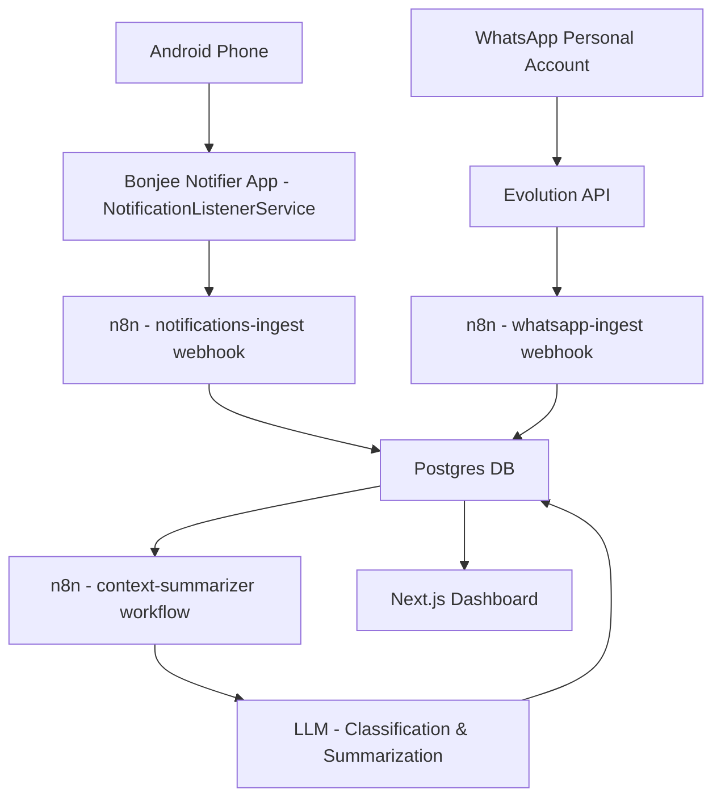

# Architecture

## Overview
Bonjee Bot is an event driven personal briefing system. Instead of summarizing on a fixed interval, n8n will evaluate every new message/notification and decide if a summary should be generated based off of context. 

## Data Flow

## Components

| Component | Purpose | Hosting |
| :-- | :-- | :-- |
| Evolution API | QR pair with your personal WhatsApp, forward DMs and Groups via webhooks | Render Web Service + Persistent Disk |
| n8n | Ingest, normalize, classify, deduplicate, and decide when to summarize | Render Web Service + Postgres |
| Postgres | Source of truth for messages, notifications, summaries, and state | Render Managed Postgres |
| Android Notifier App | Uses `NotificationListenerService` to grab all notifications and POST them to n8n | Sideloaded APK onto your Android device |
| Next.js Dashboard | View latest brief, deadlines, action items, timeline, and settings | Render Web Service/Static Site | 

## Phone Commands (offline)

The Android app answers a set of spoken/typed sentences on the phone itself before it
touches the network. `device/DeviceActions.kt` is the engine and
`device/CommandCatalog.kt` is the single list of supported sentences (also shown on the
Device Commands screen and spoken for "what can you do").

| Group | Examples | How it works |
| :-- | :-- | :-- |
| Apps | `open WhatsApp`, `launch Gmail` | Resolves launcher activities through `<queries>` (MAIN/LAUNCHER), no `QUERY_ALL_PACKAGES` |
| Calls / texts | `call mum`, `text John saying I am coming` | Contacts lookup + `ACTION_CALL` (falls back to `ACTION_DIAL` without `CALL_PHONE`) |
| Screen / sound | `brightness 60 percent`, `volume up`, `mute` | `Settings.System` when "Modify system settings" is granted, otherwise window brightness; `AudioManager` for volume/ringer |
| Quick controls | `torch on`, `next song`, `set alarm for 6:30 am` | Camera2 torch, media key events, `AlarmClock` / calendar insert intents |
| Search | `youtube ...`, `navigate to ...`, `search for ...` | `ACTION_VIEW` deep links to the installed app or browser |
| Panels | `wifi`, `bluetooth`, `location` | Opens the system panel and says so; Android forbids silent toggles |
| Info | `battery`, `time`, `storage`, `read my notifications` | Local APIs + the listener's last 20 notifications |

It runs inside the existing assistant flow: `AskActivity` offers every sentence to the
engine first, and `NotHandled` falls through to the same `personal-ai-ask` webhook, so
archive questions behave exactly as before (including offline failures).

## Context Based Timing
The `context-summarizer` workflow will run after every ingest, or be triggered internally. It will check the following rules against the newly ingested items: 

| Rule | Condition | Action |
| :-- | :-- | :-- |
| Urgent Keywords | Contains words like `asap`, `urgent`, `emergency`, `deadline`, `due`, `overdue`, `pay now` | Flag as urgent, potentially trigger immediate summary if not in debounce window |
| Direct Mentions | You're @'d in a group, or your name is mentioned. Also works for DMs asking for you directly | Increase priority score |
| Questions/Requests | LLM classifies as "needs action", "question directed to you", or "request" | Becomes an action item, can trigger summary |
| Time Entities | Extracted dates/times (e.g "tomorrow at 5pm", "friday", "25th Oct", "by EOD") | Added to `deadlines` table, prioritized if within 24 hours |
| Burst Detection | >= 5 new items within the last 15 minutes | Treat as a busy period and summarize to catch you up |
| High Priority Apps | Notifications from apps such as Gmail, Google Calendar, Outlook, Banking apps, etc. containing time/event info | Boost priority | 

To prevent spam, we use a `context_state` table with `last_summary_at`, `debounce_until`, and `priority_score`. Summaries will only be generated if `priority_score >= THRESHOLD` or if it's been over a configurable cooldown period with new relevant items. 

## Security Notes
- All webhooks from your phone should be sent over HTTPS
- Use strong credentials for n8n, Postgres, and Evolution API
- Consider putting n8n behind basic auth or IP restrictions if needed
- The Android app only needs to hit your n8n webhook, no other external endpoints
- All data stays within your Render services + DB
- RLS should be enabled for the dashboard if you add auth
